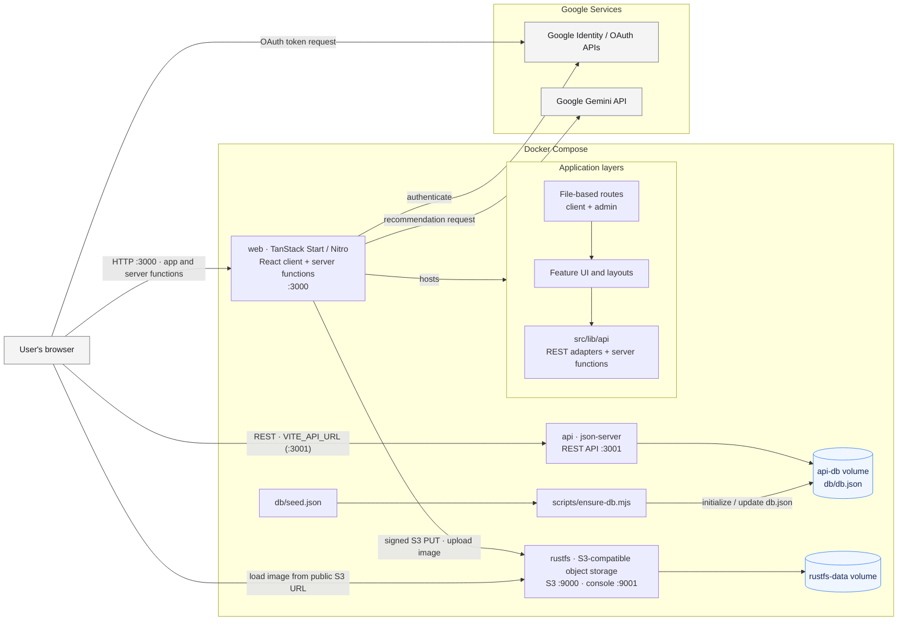

# Architecture

The browser calls json-server directly for application data. Image uploads,
Google token verification, and optional AI recommendations run through
TanStack Start server functions; image downloads are served directly from the
public RustFS bucket.
